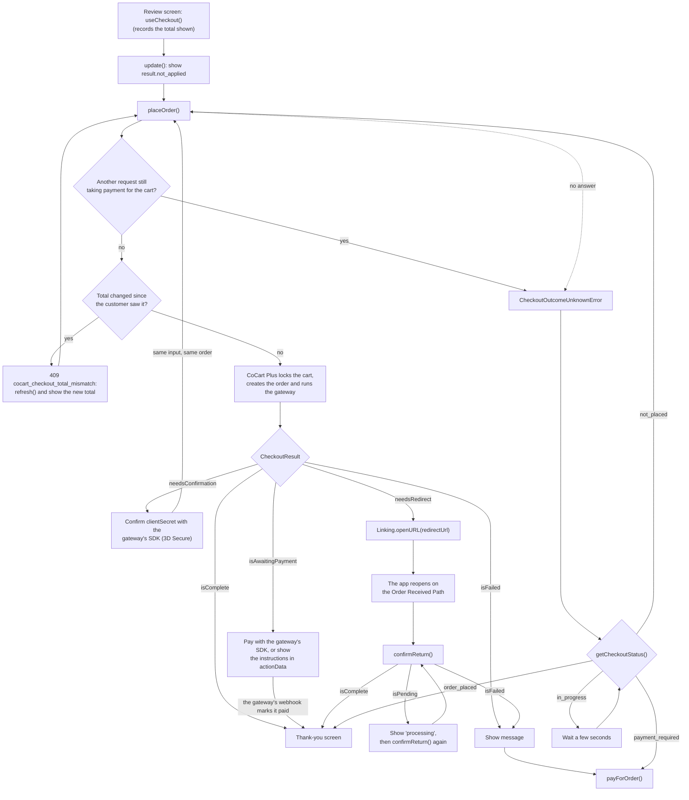

# Checkout

> Requires **CoCart Plus 2.0** and at least one WooCommerce payment gateway.

Checkout turns the customer's cart into an order and takes payment. **The card never passes through the CoCart SDK**:
- The gateway's own React Native SDK (for Stripe, `@stripe/stripe-react-native` with your publishable key) collects the card and sends it straight to the gateway.
- Your app gets back a payment method ID, and places the order with it.

- [Setup](#setup)
- [How It Works](#how-it-works)
- [Quick Start](#quick-start)
- [Showing the Checkout](#showing-the-checkout)
- [Placing the Order](#placing-the-order)
- [Reading the Result](#reading-the-result)
- [3D Secure in the App](#3d-secure-in-the-app)
- [Off-Site Steps](#off-site-steps)
- [Saved Cards](#saved-cards)
- [The Thank-You Screen](#the-thank-you-screen)
- [Paying for an Unpaid Order](#paying-for-an-unpaid-order)
- [Address Autocomplete](#address-autocomplete)
- [Errors Before Payment](#errors-before-payment)
- [When No Answer Comes Back](#when-no-answer-comes-back)
- [Changing a Subscription's Payment Method](#changing-a-subscriptions-payment-method)

## Setup

Checkout comes from the core SDK's checkout package:

```bash
npm install @cocartheadless/checkout
npm install @stripe/stripe-react-native # or your gateway's SDK
```

Add it to the provider:

```tsx
import { CoCartProvider, MMKVStorage } from '@cocartheadless/react-native-sdk';
import { createCheckout } from '@cocartheadless/checkout';
import { StripeProvider } from '@stripe/stripe-react-native';

export default function App() {
  return (
    <StripeProvider publishableKey="pk_test_…">
      <CoCartProvider
        siteURL="https://your-store.com"
        options={{ storage: new MMKVStorage() }}
        extensions={[createCheckout()]}
      >
        <Navigation />
      </CoCartProvider>
    </StripeProvider>
  );
}
```

The checkout hooks throw if `createCheckout()` isn't in `extensions`.

## How It Works

1. **Show the checkout** on the review screen with `useCheckout()` and `usePaymentMethods()`. Reading the checkout records the total the customer sees.
2. **Save what the customer enters** with `update()` from `useCheckoutMutations()`, and show anything it couldn't apply.
3. **The gateway's SDK turns the card into a payment method ID.**
4. **`placeOrder()`** creates the order and takes payment. It returns the order's `CheckoutResult`.
5. **Act on the result:**

   | Result | What to do |
   |---|---|
   | `isComplete` | Show the thank-you screen (`useOrderReceived()`) |
   | `isAwaitingPayment` | The order is placed; the customer pays now with the gateway's SDK, or by the instructions in `actionData` |
   | `needsConfirmation` | Confirm the card with the gateway's SDK (3D Secure), then call `placeOrder()` again with the same input |
   | `needsRedirect` | Open the off-site step, then call `confirmReturn()` when the app reopens |
   | `isPending` | The gateway hasn't confirmed yet: confirm again shortly |
   | `isFailed` | Show `message`; the customer can pay again with `payForOrder()` |

6. **No answer, or another payment still running for the cart:** `placeOrder()` throws `CheckoutOutcomeUnknownError`. Ask `getCheckoutStatus()` how it ended: `payment_required` → `payForOrder()`; `in_progress` → ask again; `not_placed` → place the order again.
7. **`409 cocart_checkout_total_mismatch`:** the total changed since the customer saw it. Refresh the checkout and show the new total before placing the order again.

The whole flow, including the lock CoCart Plus takes so that a double tap, or a request sent again, can't take payment twice:



The client never sends `placeOrder()` again by itself after a timeout, since it may already have run on the store. See [When No Answer Comes Back](#when-no-answer-comes-back).

The checkout hooks wait for the stored cart key, as `useCart` does, so they work on the returning guest's cart.

## Quick Start

```tsx
import { CardField, useStripe } from '@stripe/stripe-react-native';
import { useCheckoutMutations } from '@cocartheadless/react-native-sdk';

function PayButton({ billingAddress }: { billingAddress: Record<string, string> }) {
  const { createPaymentMethod } = useStripe();
  const { placeOrder } = useCheckoutMutations();

  const pay = async () => {
    const { paymentMethod, error } = await createPaymentMethod({ paymentMethodType: 'Card' });
    if (error) return Alert.alert(error.message);

    const result = await placeOrder({
      billing_address: billingAddress,
      shipping_method: 'flat_rate:1',
      payment_method: 'stripe',
      payment_data: { 'wc-stripe-payment-method': paymentMethod.id },
    });

    if (result.isComplete) {
      navigation.navigate('ThankYou', { orderId: result.orderId, orderKey: result.orderKey });
    }
    // Otherwise, see Reading the Result.
  };

  return (
    <>
      <CardField postalCodeEnabled style={{ height: 50 }} />
      <Button title="Pay" onPress={pay} />
    </>
  );
}
```

## Showing the Checkout

`useCheckout()` reads the checkout when the screen mounts, like a receipt: the items, coupons, fees, totals, the payment method, the addresses and the shipping packages.

```tsx
const { checkout, loading, error, refresh } = useCheckout();

checkout?.get('payment.needs_payment');    // false when the order is free
checkout?.get('payment.method');           // the chosen gateway ID
checkout?.get('delivery.needs_shipping');
checkout?.get('delivery.packages');        // [{ id, name, chosen_rate, rates: [{ id, method_id, instance_id, label, cost, tax }] }]
checkout?.get('totals.total');             // minor units, e.g. '1000'
checkout?.get('total_lines');              // [{ key, label, amount, detail }], in the order a receipt prints them
checkout?.get('customer.billing');         // the saved address, with `formatted` on one line
```

Use it on the screen where the customer reviews the order before paying: CoCart Plus remembers the total it showed, and refuses the order if the total has changed by the time it's placed (`409 cocart_checkout_total_mismatch`). Don't call `refresh()` just before `placeOrder()`: that would record a total the customer never saw.

Amounts are in minor units (`'1000'` for $10.00); show them with [`CurrencyFormatter`](utilities.md) and the checkout's `currency`.

Save what the customer has entered so far, without placing the order. The totals, taxes and shipping rates update to match, and `useCheckout()` refreshes:

```tsx
const { update } = useCheckoutMutations();

const updated = await update({
  billing_address: { country: 'FR', postcode: '75001' },
  shipping_method: 'flat_rate:1', // a rate's id from delivery.packages
});

updated.get('result.code'); // 'checkout_updated', or 'checkout_partly_updated'
for (const { field, code, message } of updated.get<any[]>('result.not_applied', [])) {
  showFieldError(field, message); // e.g. shipping_method: 'The shipping method "local_pickup:999" is not available.'
}
```

A coupon goes through `update()` too: `update({ coupon_code: 'SAVE10' })`, or `update({ coupon_code: 'SAVE10', coupon_action: 'remove' })`. A coupon the store won't apply is listed in `result.not_applied` alongside the changes that did go through. When nothing asked for could be applied, `update()` throws instead and changes nothing; every address field at fault is in `e.getFields()`.

The store's form settings come from the checkout client. No cart needed:

```tsx
const checkoutClient = useCheckoutClient();
const config = (await checkoutClient.getCheckoutConfig()).toObject();

config.fields.billing;                   // the field definitions, in order
config.countries.allowed_countries;      // { FR: 'France', … }
config.account.allow_registration;       // whether to offer "create an account"
config.address_autocomplete.enabled;     // whether address search works on this store
config.store.terms_text;                 // 'I agree to the terms and conditions & the privacy policy.', or null
config.store.terms_links;                // [{ text: 'terms and conditions', url }]: the words to link
config.store.terms_url, config.store.privacy_url;
config.order_received_url;               // where gateways send the customer back (see Off-Site Steps)
```

The payment methods for this cart, in the order the store lists them:

```tsx
const { methods, savedCards, loading } = usePaymentMethods();

methods?.payment_methods.map((method) => method.title);
// each: id, title, description, supports ({ tokenization, subscriptions… } as true/false), saved_tokens
```

## Placing the Order

| Field | Notes |
|---|---|
| `billing_address` | `first_name`, `last_name`, `address_1`, `city`, `postcode`, `country` and `email` at least, plus what the config marks required. Optional when `update()` already saved it |
| `shipping_address` | Same fields, when shipping goes elsewhere |
| `shipping_method` | A rate's `id` from `checkout.get('delivery.packages')` |
| `payment_method` | A gateway ID: `stripe`, `woocommerce_payments`, `paypal`, `bacs`, `cod`…; leave it out for a free order |
| `payment_data` | What the gateway needs, as an object (below) |
| `customer_note` | Optional |
| `create_account`, `customer_password` | Create an account for a guest, when the store allows it |
| `checkout_id` | Optional: 16 to 64 letters, digits, `-` or `_`. `placeOrder()` makes a random one when you leave it out, and refuses one that doesn't fit before sending (`checkout_invalid_checkout_id`) |

`payment_data` holds the keys the WooCommerce gateway reads:

| To… | Key | Value |
|---|---|---|
| Charge a new Stripe card | `wc-stripe-payment-method` | The payment method ID (`pm_…`) |
| Charge a new WooPayments card | `wcpay-payment-method` | The payment method ID |
| Charge a saved card | `wc-{gateway}-payment-token` | The saved card's `id` |
| Save the new card for later | `wc-{gateway}-new-payment-method` | `true` |

`payment_data` carries what the gateway's SDK gives you (a payment method ID, a saved card's ID), never card numbers or CVCs: those go from the gateway's own fields straight to the gateway.

Offline gateways (`bacs`, `cheque`, `cod`) need no `payment_data`. A free order (`payment.needs_payment` is `false`) needs neither `payment_method` nor `payment_data`. Calling `placeOrder()` again for the same cart updates the same order rather than creating a second one.

## Reading the Result

`placeOrder()`, `payForOrder()` and `confirmReturn()` return the order with what the payment did in `result`, read as a `CheckoutResult`:

```tsx
if (result.isComplete) {
  navigation.navigate('ThankYou', { orderId: result.orderId, orderKey: result.orderKey });
} else if (result.isAwaitingPayment) {
  await payInApp(result);                 // Cash App Pay, WeChat Pay, a voucher, BLIK, a bank transfer
} else if (result.needsConfirmation) {
  await confirmCard(result);              // 3D Secure in the app
} else if (result.needsRedirect) {
  await Linking.openURL(result.redirectUrl!);
} else if (result.isPending) {
  navigation.navigate('Processing');      // confirm again shortly
} else {
  Alert.alert('Payment failed', result.message); // 'Your card was declined.'
}
```

`CheckoutResult`:

| Property | Meaning |
|---|---|
| `code` | `result.code`: `'order_placed'`, `'action_required'`, `'payment_pending'`, `'payment_failed'`, `'payment_method_changed'` (a subscription), or another string (`PaymentResultCode`) |
| `isComplete` | `true` for `order_placed` (or `payment_method_changed`) with nothing left to do: paid, free, or held for review or offline payment. `orderStatus` says which (`processing`, `on-hold`…) |
| `isAwaitingPayment` | `true` for `order_placed` with an action: the order is placed, but the customer still pays ([Cash App Pay, WeChat Pay and vouchers](#cash-app-pay-wechat-pay-and-vouchers)) |
| `needsConfirmation` | `true` for `action_required` with a `clientSecret`: the card needs an in-app step |
| `needsRedirect` | `true` for `action_required` with an off-site address: the payment needs an off-site step |
| `isPending` | `true` for `payment_pending`: the gateway hasn't confirmed the payment yet |
| `isFailed` | `true` for `payment_failed` |
| `object` | `'order'`, or `'subscription'` after a subscription's payment method change |
| `orderId`, `orderKey`, `orderNumber`, `orderStatus` | The order: its `id`, `key`, `number` and `status.code` |
| `subscriptionId` | The subscription, when `object` is `'subscription'` |
| `redirectUrl` | The off-site step, or the order-received page. Only ever an `https` or `http` address: anything else in the response (a `javascript:` URL, another app's link) is left out |
| `clientSecret`, `intentType` | For [3D Secure in the app](#3d-secure-in-the-app) and `isAwaitingPayment` |
| `paymentMethodType` | For `isAwaitingPayment`: `cashapp`, `wechat_pay`, `boleto`, `oxxo` or `multibanco` |
| `message` | Always set: why it failed, or that the order was received. Show it to the customer |
| `errorCode` | CoCart's code to branch on when it failed (below) |
| `gatewayErrorCode`, `gatewayMessage` | The gateway's own code and message, for your logs |
| `actionType`, `actionData` | The raw extra step, e.g. a Multibanco voucher (`'wcpay_multibanco_voucher'`) |
| `response` | The raw `Response`: the order (or the subscription) |

A declined card is a `200` with `payment_failed`, not a thrown error. Errors are kept for requests the store refuses before it tries to take payment ([below](#errors-before-payment)).

`message` and `gatewayMessage` are plain text: show them in a `<Text>`, never as HTML (in a `WebView`, for example).

| `errorCode` | Meaning |
|---|---|
| `card_declined` | Declined, including for fraud |
| `insufficient_funds` | Not enough funds |
| `expired_card` | The card has expired |
| `incorrect_cvc`, `incorrect_number`, `incorrect_postcode` | Wrong details |
| `authentication_failed` | 3D Secure failed or was cancelled |
| `processing_error` | The gateway had a problem; try again |
| `payment_method_not_supported`, `amount_not_supported` | The gateway can't take this payment |
| `payment_failed` | The gateway didn't say why |

## 3D Secure in the App

Confirm `clientSecret` with Stripe, then call `placeOrder()` again with the same input. It completes the same order.

```tsx
const { handleNextAction, handleNextActionForSetup } = useStripe();

const confirmCard = async (result: CheckoutResult) => {
  const { error } = result.intentType === 'setup_intent'
    ? await handleNextActionForSetup(result.clientSecret!)
    : await handleNextAction(result.clientSecret!);
  if (error) return Alert.alert(error.message);

  const retried = await placeOrder(order); // same input as before
  // read `retried` as above
};
```

## Cash App Pay, WeChat Pay and Vouchers

With these payment methods the order is placed before the customer pays, so `isAwaitingPayment` is `true` rather than `isComplete`. The cart has already been emptied.

With Stripe's Cash App Pay, WeChat Pay, and Boleto, OXXO or Multibanco vouchers, the result has a `clientSecret`. Hand it to `@stripe/stripe-react-native`'s `handleNextAction` the same way as [3D Secure in the App](#3d-secure-in-the-app): it opens Cash App, shows WeChat Pay, or shows the voucher. `paymentMethodType` says which it is: `cashapp`, `wechat_pay`, `boleto`, `oxxo` or `multibanco`.

Without a `clientSecret`, `actionType` says what to show from `actionData`:

| `actionType` | Show |
|---|---|
| `stripe_blik_confirmation_pending` | Ask the customer to approve the payment in their banking app |
| `wcpay_multibanco_voucher` | `entity`, `reference`, and a link to `voucher_url`, before `expires_at` |
| `mollie_bank_transfer_instructions` | `beneficiary_name`, `iban`, `bic` and `payment_reference`, before `expires_at` |
| `mercadopago_pix_payment` | The Pix QR code (`qr_code_base64`) or the code to copy (`qr_code`) |
| `mercadopago_ticket_payment` | A link to `voucher_url` |

The gateway's webhook marks the order paid, so don't call `placeOrder()` again. `getCheckoutStatus()` says `payment_required` until the payment goes through, then `order_placed`. A voucher is paid later, at a bank or a shop. If the customer gives up, the order stays unpaid, and `payForOrder()` takes another payment for it.

## Off-Site Steps

Some payments finish on another site: PayPal approval, or a Stripe-hosted 3D Secure page. Open it with `Linking.openURL(result.redirectUrl)`. `redirectUrl` is only ever an `https` or `http` address, so the response can't make the app open something else.

The customer comes back to the thank-you page: the **Order Received Path** set in CoCart Plus under Settings → Checkout (`/checkout/order-received/{order_id}/` by default), on your **Front-end site URL**. To have that open your app, add a Universal Link (iOS) and an App Link (Android) for the same path. It must match the setting, so if the setting changes, the app has to change too. Then hand the URL to `confirmReturn()`:

```tsx
const { confirmReturn } = useCheckoutMutations();

useEffect(() => {
  const subscription = Linking.addEventListener('url', async ({ url }) => {
    // The Order Received Path set in CoCart Plus, without {order_id}
    if (!url.includes('/checkout/order-received/')) return;

    const result = await confirmReturn(url);
    if (result.isComplete) {
      navigation.navigate('ThankYou', { orderId: result.orderId, orderKey: result.orderKey });
    } else if (result.isPending) {
      navigation.navigate('Processing'); // call confirmReturn(url) again shortly
    } else {
      Alert.alert('Payment failed', result.message); // offer payForOrder()
    }
  });
  return () => subscription.remove();
}, []);
```

`confirmReturn()` is safe to call more than once. It sends the order key in the request body, not the URL. If your link carries the order elsewhere: `confirmReturn(url, { orderId: 123, orderKey: 'wc_order_…' })`.

`getCheckoutConfig()` gives the URL customers come back to as `order_received_url`, e.g. `https://shop.example.com/order/{order_id}?key={order_key}&order_id={order_id}`, so you know which route (or, in an app, which link) to handle.

A subscription's payment method change can send the customer off-site too (a bank, for example). They come back the same way, with the subscription's ID, and the same return call finishes the change: `isComplete` (`payment_method_changed`, with `subscriptionId`) once the new payment method is set, `isFailed` when it wasn't confirmed.

## Saved Cards

A logged-in customer's saved cards:

```tsx
const { savedCards } = usePaymentMethods();             // every gateway
const { savedCards: stripeCards } = usePaymentMethods({ gateway: 'stripe' });

savedCards.map((card) => (
  <Text key={card.id}>
    {card.label} {/* 'Visa ending in 4242' */} · {card.expires} {card.isDefault ? '(default)' : ''}
  </Text>
));
// card.id, card.gatewayId, card.type, card.supportsSubscriptions
```

Pay with one with `payment_data: { 'wc-stripe-payment-token': card.id }`. To save a new card, add `'wc-stripe-new-payment-method': true`.

## The Thank-You Screen

```tsx
const fmt = new CurrencyFormatter();

function ThankYou({ route }) {
  const { order, loading } = useOrderReceived(route.params.orderId, route.params.orderKey);
  if (loading || !order) return <ActivityIndicator />;

  return (
    <View>
      <Text>Order #{order.get('number')}: {order.get('status.label')}</Text>
      {order.get<any[]>('total_lines', []).map((line) => (
        <Text key={line.key}>{line.label}: {fmt.format(Number(line.amount), order.get('currency'))}</Text>
      ))}
    </View>
  );
}
```

`order.get('payment.needs_payment')` is `true` if the customer still has to pay; `order.get('status.code')` is the status to branch on (`processing`, `on-hold`, `pending`…). A wrong key, or someone else's order, is `404 cocart_order_not_found`.

## Paying for an Unpaid Order

Use it after a failed payment, for a `payment_required` checkout status, or when the customer comes back to an unpaid order:

```tsx
const { payForOrder } = useCheckoutMutations();

const result = await payForOrder(orderId, orderKey, {
  payment_method: 'stripe',
  payment_data: { 'wc-stripe-payment-method': paymentMethod.id },
});
```

It returns the same `CheckoutResult` as `placeOrder()`, and you read it the same way:

- a declined card is `result.isFailed`, not a thrown error;
- a card that needs 3D Secure gives `result.needsConfirmation`: confirm it as in [3D Secure in the App](#3d-secure-in-the-app), then call `payForOrder()` again;
- an off-site step gives `result.needsRedirect`.

The order key goes in the request body, not the URL. An order that needs no payment or can't be paid is a `409` (`cocart_order_no_payment_needed`, `cocart_order_invalid_status`), and so is another payment still running for it (`cocart_payment_in_progress`): check the order before trying again.

## Address Autocomplete

```tsx
const checkoutClient = useCheckoutClient();

const found = await checkoutClient.searchAddresses({ query: '10 Downing', country: 'GB' });
const details = await checkoutClient.getAddressDetails({ address_id: suggestionId, provider: found.get('provider.id') });
details.get('address'); // address_1, city, postcode, country
```

The search needs at least 3 characters, and neither call needs a cart. It needs an address provider on the store: check `getCheckoutConfig()`'s `address_autocomplete.enabled` first. Without one, the search is `404 cocart_address_search_no_provider`, and the customer types the address in.

## Errors Before Payment

When the store refuses the order before trying to take payment, `placeOrder()` throws a `CoCartError`. Nothing was changed:

```tsx
import { CoCartError } from '@cocartheadless/react-native-sdk';

try {
  const result = await placeOrder(order);
} catch (e) {
  if (e instanceof CoCartError) {
    e.errorCode;   // e.g. 'cocart_invalid_address_fields'
    e.message;     // to show the customer
    e.getFields(); // every address field at fault: { 'billing.postcode': 'The postcode … is not valid for France.' }
    e.getField();  // the first one, or null
  }
}
```

| Code | HTTP | Meaning |
|---|---|---|
| `cocart_cart_empty` | 409 | The cart is empty |
| `cocart_field_required`, `cocart_invalid_address_fields` | 400 | A required field is missing or wrong (see `getFields()`) |
| `cocart_invalid_email`, `cocart_invalid_phone_number` | 400 | Invalid email or phone |
| `cocart_no_shipping_method`, `cocart_invalid_shipping_method` | 400 | No shipping method, or one that doesn't apply |
| `cocart_payment_method_required` | 400 | The cart needs paying for and no `payment_method` was given |
| `cocart_invalid_payment_method`, `cocart_payment_method_not_available`, `cocart_payment_method_disabled` | 400 | The payment method can't be used |
| `cocart_payment_method_no_subscription_support` | 400 | The cart has a subscription and the gateway can't renew it |
| `cocart_product_out_of_stock`, `cocart_insufficient_stock`, `cocart_product_not_purchasable`, `cocart_product_not_exists` | 400 | A product can't be bought any more |
| `cocart_invalid_coupon`, `cocart_coupon_usage_limit`, `cocart_coupon_email_restricted` | 400 | A coupon no longer applies (named in the error's `data.coupon`; it stays applied until removed) |
| `cocart_account_creation_failed` | 400 | `create_account` failed |
| `cocart_account_exists` | 409 | `create_account` and the email already has an account: the customer signs in |
| `cocart_checkout_total_mismatch` | 409 | The total changed since the customer saw it: `refresh()` the checkout, show the new total, then place the order again |
| `checkout_invalid_checkout_id` | — | Thrown before sending: the `checkout_id` you passed doesn't fit |

400s are `ValidationError`s; 409s, 429s and 5xx are plain `CoCartError`s, never `ValidationError`, so check `errorCode`.

`409 cocart_payment_in_progress` (another request is still taking payment for the cart, e.g. after a double tap) comes from `placeOrder()` as `CheckoutOutcomeUnknownError`, as a lost answer does: see below. Paying for an order and changing a subscription's payment method throw it as a plain `CoCartError`.

## When No Answer Comes Back

If the connection drops, the request times out or a proxy gives up waiting, the order may or may not have been placed. The same goes when another request is still taking payment for the cart (`409 cocart_payment_in_progress`). Each order is sent with a random `checkout_id`, so `placeOrder()` throws `CheckoutOutcomeUnknownError` with that ID, and `getCheckoutStatus()` asks CoCart Plus 2.0 how the checkout ended. Ask from the same cart, or as the same customer.

```tsx
import { CheckoutOutcomeUnknownError } from '@cocartheadless/checkout';

const { placeOrder, getCheckoutStatus } = useCheckoutMutations();

try {
  result = await placeOrder(input);
} catch (error) {
  if (!(error instanceof CheckoutOutcomeUnknownError)) throw error;

  const status = await getCheckoutStatus(error.checkoutId);
  switch (status.code) {
    case 'order_placed':     // It went through: show status.orderId with status.orderKey.
    case 'payment_required': // Placed but not paid: payForOrder(status.orderId!, status.orderKey!, …).
    case 'in_progress':      // Still running: ask again in a few seconds.
    case 'not_placed':       // Nothing went through: placeOrder(input) again.
  }
}
```

`getCheckoutStatus()` returns `{ checkoutId, code, message, orderId, orderKey, orderNumber, orderStatus }`. The order fields are `null` unless the code is `order_placed` or `payment_required`.

`CheckoutOutcomeUnknownError` is a `CoCartError` with the original error's codes (`request_timeout`, `network_error`, the proxy's 502 or 504, or `cocart_payment_in_progress`). Put your own `checkout_id` in the input if you'd rather keep it yourself.

If the gateway's webhook paid the order after a 3D Secure confirmation in the app, placing the order again reports that order as complete rather than placing another.

## Changing a Subscription's Payment Method

See [Account](account.md#changing-a-subscriptions-payment-method).
